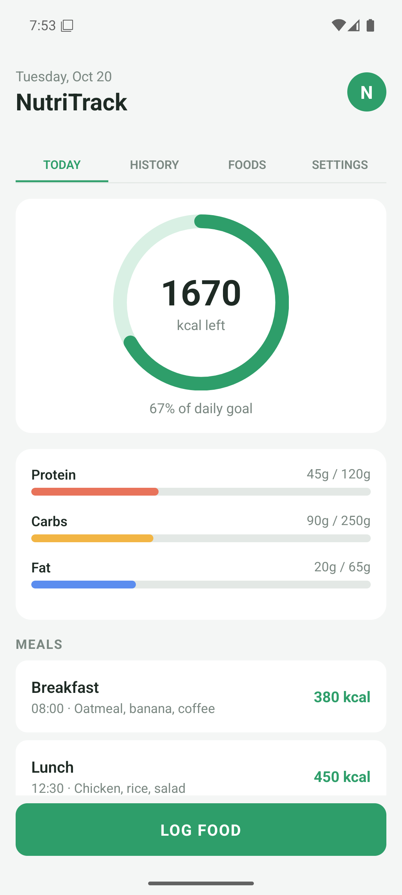

# nutri_track_demo

A nutrition dashboard screen ("NutriTrack") built with React Native CLI and TypeScript, using mock data. It recreates a design mockup as a coding challenge.

**Version 0.1.0**



## What's in it

- **Header**: today's date, the app name and logo.
- **Tabs**: Today, History, Foods and Settings (only Today has content for now).
- **Daily calorie ring**: calories left and the percentage of the daily goal.
- **Macro bars**: protein, carbs and fat progress against their goals.
- **Meals list**: meal cards with time, description and calories.
- **Add Meal / Log Food**: adds a meal to the list and the ring updates right away.

## About the mockup

The original mockup shows Carbs twice and Protein without a progress bar. This version shows all three macros (protein, carbs, fat), each with its own bar.

## Stack

- TypeScript + React Native CLI (no Expo)
- react-native-svg for the calorie ring
- Local mock data (no backend)

## Project structure

```
src/
  types.ts          data shapes (Macro, Meal, Tab)
  data/mock.ts      mock data (calorie goal, macros, meals, tabs)
  theme.ts          colors and spacing
  screens/          DashboardScreen: holds the state and composes the screen
  components/       Header, TabBar, CalorieRing, MacroBar, MealCard, AddMealCard, LogFoodButton
```

## How to run

Requires Node 22+, JDK 17 and Android Studio with an emulator running.

```bash
git clone https://github.com/MedusoDev/nutri_track_demo.git
cd nutri_track_demo
npm install
npm run android
```

---

Made by [Gabriel Barros](https://github.com/MedusoDev).
