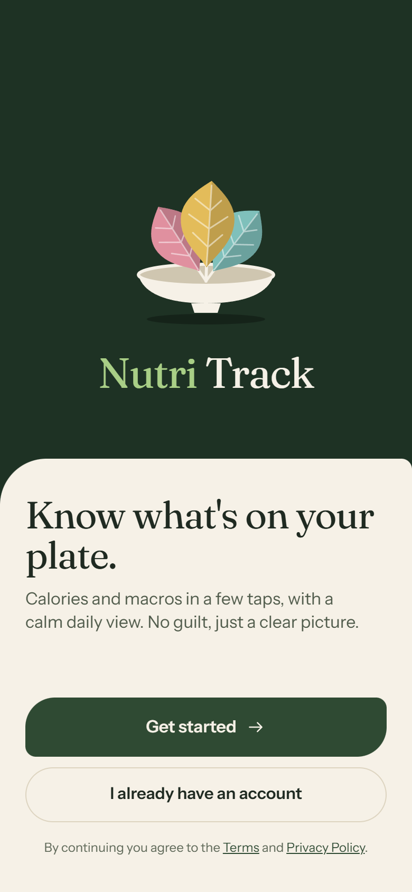

# nutri_track_demo

Demo of **Nutri Track**, a calm calorie and macro tracker built with React Native CLI and TypeScript.
It started as a coding challenge (recreate a nutrition dashboard mockup) and grew into a complete demo with a new design.

**Version 0.2.0** · new design



## What's in this demo

- **Splash**: the logo animates in: a plate rises and three leaves (protein, carbs, fat) sprout from it.
- **Onboarding**: goal, body data and pace. The app calculates the daily calories, macros and water target (Mifflin–St Jeor) and shows how it got there.
- **Today**: calories left, three leaves that fill with protein, carbs and fat, a water drop that fills up, and the day's meals, each on a small sky of the time it was eaten.
- **Log food**: pick the meal and the time, search or browse Recent, Favorites, Library and My recipes, adjust the portion in grams or servings, add several foods to the plate and log them all at once, with undo.
- **Meal detail**: totals of a meal; swipe a food to edit or remove it, or copy the meal to another day.
- **History**: week bars against the goal, a month calendar (on target, under, over, not logged), the streak and the weight trend.
- **Foods**: the library, favorites, recipes to try, brands and your own foods (the form checks that the macros match the calories).
- **Settings**: edit the profile and the targets are recalculated, change goals, units, theme and reminders.
- **Demo data**: Settings can show the app as a new user (day 1) or as someone who has used it for 2 months.

## Stack

- TypeScript + React Native CLI
- react-native-svg for the logo, leaves, charts and icons
- React Native Animated for the animations (most run on the native driver), no extra animation library
- AsyncStorage to keep the data on the phone
- Local mock data (no backend)
- Jest for the unit tests

## Project structure

```
App.tsx               splash -> onboarding -> tabs
src/
  theme.ts            design tokens (light and dark), fonts
  types.ts            data shapes
  data/               food list, first-launch state, 2-month demo history
  state/              app state (reducer + context + local storage), screen stack
  utils/              nutrition maths and the daily target calculation
  components/         UI kit, logo, tab bar, toast...
  screens/            Splash, onboarding, Today, log/ (Log food, Food detail, Meal detail),
                      History, foods/ (Foods, Create food), Settings
__tests__/            unit tests
```

## How to run

Requires Node 22+, JDK 17 and Android Studio with an emulator running.

```bash
git clone https://github.com/MedusoDev/nutri_track_demo.git
cd nutri_track_demo
npm install
```

Start Metro in one terminal and wait until it is ready:

```bash
npm start
```

Then, in a second terminal, build and open the app on the emulator:

```bash
npm run android
```

Run the tests with `npm test`.

---

Made by [Gabriel Barros](https://github.com/MedusoDev).
